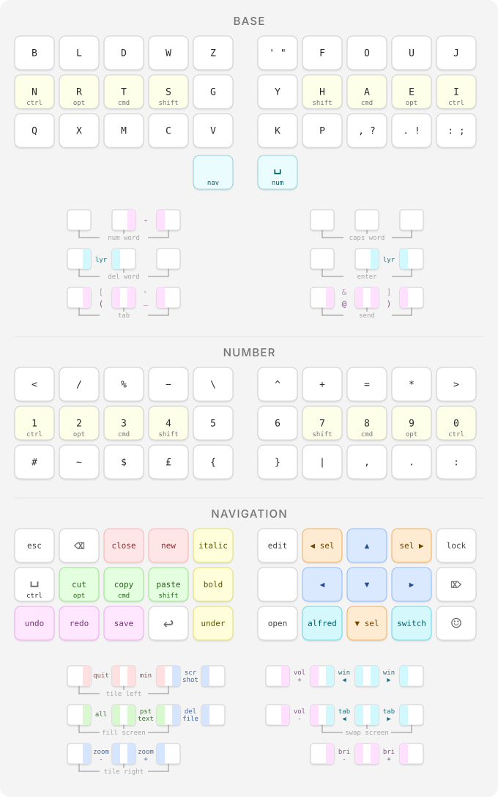

# @dave-thompson's QMK keymap

My personal keymap, implemented as a qmk external userspace.  The main keymap is [dave-thompson.c](dave-thompson.c), with shared settings in [config_dave-thompson.h](config_dave-thompson.h) and [rules.mk](rules.mk). Each keyboard has a small board-specific folder mapping the main keymap to its specific board layout (e.g. [ErgoDox EZ Glow](keyboards/ergodox_ez/glow/keymaps/dave-thompson)).

 

